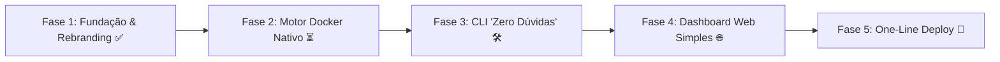

# Dopinio 🐳

> **Da sua máquina para a URL com um único comando — 100% no Docker, sem o peso do Kubernetes.**

O **Dopinio** é uma plataforma de desenvolvimento (PaaS) leve, moderna e descomplicada. 

Enquanto o projeto original (Epinio) exigia clusters gigantescos de Kubernetes, Ingress Controllers complexos, Cert-Manager e dezenas de dependências difíceis de configurar, o **Dopinio** foi redesenhado do zero para quem quer **simplicidade absoluta com o Docker**:
- Instalação em **1 minuto** com Docker Compose.
- Não precisa entender nada de Kubernetes ou YAML infinito.
- Suas aplicações ganham domínio, SSL e rotas automáticas na hora.

---

## 💾 Projeto Forkado & Backup do Epinio Original

> **Nota de Arquivamento:** Este projeto nasceu a partir de um fork do Epinio. Para manter o repositório leve e focado exclusivamente no ecossistema Docker, todas as branches antigas do Kubernetes foram desplugadas. Um backup completo contendo **todas as branches e histórico do Epinio original** está compactado e preservado neste repositório no arquivo:
> 📦 [`epinio-original-full-backup.zip`](./epinio-original-full-backup.zip)

---

## ⚡ Instalação Rápida (Para Qualquer Usuário)

Você só precisa ter o **Docker** instalado na sua máquina. Nada mais.

### 1. Clonar o repositório
```bash
git clone https://github.com/heitorsecurity/dopinio.git
cd dopinio
```

### 2. Subir a plataforma
```bash
# Copia as configurações padrão prontas para uso
cp .env.example .env

# Sobe tudo em segundo plano
docker compose up -d
```

Pronto! Sua PaaS já está rodando.

---

## 🖥️ Painéis e Acessos Padrão

Assim que você sobe o Dopinio, os seguintes serviços ficam disponíveis:

| Serviço | Endereço | Descrição |
| :--- | :--- | :--- |
| **API do Dopinio** | `http://api.dopinio.localhost:8443` | API central que orquestra suas aplicações |
| **Traefik Proxy** | `http://localhost:80` | Roteador dinâmico automático com suporte a SSL |
| **Painel do Traefik** | `http://localhost:8080` | Interface visual de rotas e conexões |
| **Registro de Imagens** | `http://localhost:5000` | Registry Docker interno para guardar suas imagens |
| **MinIO Console** | `http://localhost:9001` | Armazenamento de arquivos e fontes |

*Credenciais padrão no `.env`: Usuário `admin` / Senha `change_this_secure_password`.*

---

## 🚀 Como Funciona no Dia a Dia

O Dopinio cuida de todo o trabalho chato de infraestrutura para você:

1. **Você cria seu código:** em Node.js, Python, Go, Rust, PHP, etc.
2. **Você envia:**
   ```bash
   dopinio push --name meu-app
   ```
3. **O Dopinio faz o resto:**
   - Detecta e constrói a imagem Docker automaticamente.
   - Sobe o contêiner na rede isolada `dopinio-net`.
   - Gera um domínio automático para você: `http://meu-app.workspace.dopinio.localhost`.
   - Gerencia logs e reinicializações automáticas.

---

## 🗺️ Roteiro de Fases do Dopinio (Muito Mais Simples que o Epinio)



### ✅ Fase 1: Fundação & Rebranding (Concluída)
- Módulo e CLI renomeados para `dopinio`.
- Stack completa com `docker-compose.yml`, `Dockerfile` multi-stage, Traefik, MinIO e Registry.
- Limpeza de branches antigas e arquivamento do Epinio original no backup `.zip`.

### ⏳ Fase 2: Motor Docker Nativo (`internal/dockerengine`)
- Conexão direta com o socket do Docker (`/var/run/docker.sock` ou Windows named pipes).
- Gerenciamento de ciclo de vida do contêiner (criar, parar, reiniciar, deletar).
- Integração de volumes persistentes e injeção de variáveis de ambiente sem precisar de Kubernetes Secrets/ConfigMaps.

### 🛠️ Fase 3: CLI "Zero Dúvidas"
- Comandos simples e intuitivos:
  - `dopinio up`: sobe o servidor local.
  - `dopinio push`: publica o app da pasta atual direto para a URL.
  - `dopinio apps`: lista aplicações com consumo de memória e status.
  - `dopinio logs <app>`: exibe logs em tempo real sem sintaxe estranha.

### 🌐 Fase 4: Dashboard Web Integrado
- Interface gráfica moderna e responsiva para criar, configurar e monitorar seus apps diretamente pelo navegador, com métricas em tempo real.

### 🚀 Fase 5: One-Line Install Script
- Instalação com uma única linha no Linux/macOS (`curl -fsSL https://dopinio.io/install.sh | sh`) ou script PowerShell no Windows.

---

## 🤝 Licença
Distribuído sob a licença Apache-2.0. Baseado no projeto Epinio.
